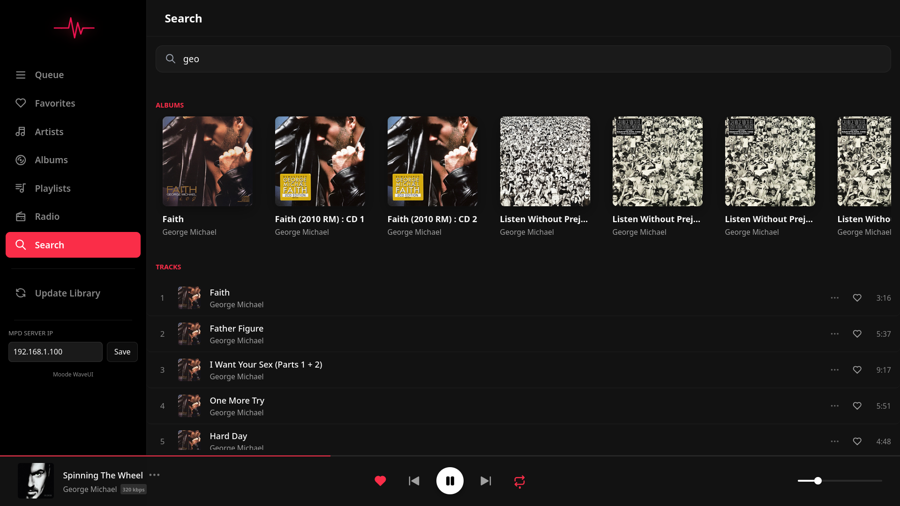
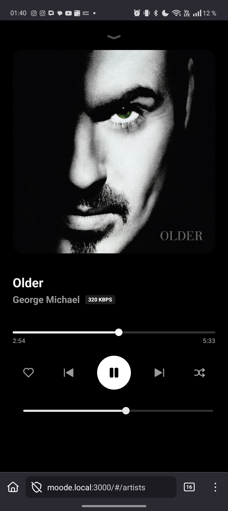
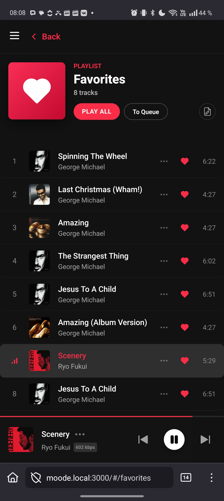

# Wave-UI for moOde Audio

A lightweight, high-performance web interface for **moOde Audio**, built to be fast, modern, and perfectly suited for mobile devices.

<p align="center">

  <br> <br>
 
</p>

## Key Features

1. **Svelte-Powered Frontend:** Built with **Svelte** for maximum speed. It feels lightning-fast compared to standard web interfaces because it compiles to highly efficient vanilla JavaScript.
2. **Modern Mobile Experience:** Designed from the ground up to be mobile-friendly. Responsive layouts, touch-optimized sliders, and intuitive gestures make it feel like a native app.
3. **Local Indexing (IndexedDB):** * No more waiting for the server to load lists.
* Metadata is stored in a local **IndexedDB** in your browser.
* Synchronization is handled by a background **Web Worker**, ensuring the UI never freezes while updating thousands of tracks.


4. **Native Integration:** * Communicates directly with **MPD** via WebSockets for real-time playback control.
* Hooks into native **moOde PHP methods** for library synchronization and system functions.


5. **Smart Caching:** Uses a **Service Worker** to cache album art locally, saving bandwidth and making the interface load instantly on repeated visits.

## Installation

The automated script handles cloning, setting up the systemd service for the WebSocket bridge, and configuring Nginx.

### One-click install on moOde server:

```bash
wget -qO- https://raw.githubusercontent.com/dmitrymake/wave-ui/main/install.sh | bash

```

**Network Access:**
The UI is served on **port 3000** (e.g., `http://moode.local:3000`).
*Note: We use port 3000 instead of a dedicated `.local` name because mDNS typically only supports one primary hostname per IP. Using a specific port is the most reliable way to avoid conflicts with the main moOde interface.*

## Direct MPD Control

Wave-UI uses `websockify` to bridge the MPD protocol over WebSockets. This allows for near-zero latency when skipping tracks or adjusting volume, providing instant feedback.

## Yandex Music

Yandex Music uses the [unofficial `yandex-music` Python SDK](https://github.com/MarshalX/yandex-music-api), pinned in `src/api/yandex-requirements.txt`. Python **3.10+** is required by the Wave bridge. MPD remains the audio player; there is no browser playback or external player process.

### Radio / My Vibe

“My Vibe” and track/artist/album/activity stations use **rotor radio sessions**, not repeated legacy station-track requests. Each MPD queue item retains its own session and batch IDs. The worker reports actual starts, natural finishes and skips; the frontend's skip request is only an intent hint, not a second feedback sender. Pauses and seeks do not inflate listening time. Feedback is kept in a retry outbox; delivery is at-least-once with the original event timestamp across retries, not a claim of exactly-once upstream delivery.

The last 500 played IDs are retained in `/var/local/www/yandex-music/history.json`; the most recent 100 plus queued tracks are excluded from radio refills. A duplicate-only response never disables this guard: the bridge attempts a replacement session, then backs off if Yandex still returns no new tracks. The history survives reboots and resets when the connected account changes. Radio owns a sequential sliding MPD window, so repeat, single, random and consume are disabled while it manages the queue. Selecting local music stops automatic Yandex replenishment.

The existing “stop daemon” control stops **replenishment**, not the currently playing song. Favorites/playlist “Play all” continues paging beyond the first page. Removing a heart removes a favorite; it does not send a recommendation dislike.

### Installation, credentials and rollback

Both `install.sh` and `install_dev.sh` install `wave-yandex.service`, an isolated venv under `/opt/wave-yandex`, and the thin `/wave-yandex-api.php` proxy. To update only this backend from a local checkout **on moOde**:

```bash
bash scripts/install-yandex.sh
sudo systemctl status wave-yandex.service
journalctl -u wave-yandex.service -n 50
```

On the first upgrade, the existing `/var/local/www/yandex_token.dat` token is imported into `/var/local/www/yandex-music/token.dat` with mode `0600`; it is not returned to the browser or included in diagnostics. The original token and old PHP daemon files on the device are left in place for rollback, but are no longer executed or installed from this repository. Subsequent token changes affect the new private token file.

The installer backs up the previous proxy, systemd unit and installed Python sources under `/var/backups/wave-yandex/<timestamp>-<pid>/` (root-only), and attempts to restore them and the dependency pins if installation or the startup health check fails. The [migration record](docs/YANDEX_MIGRATION.md) preserves device verification limits, the original backup locations and manual PHP rollback instructions. A manual rollback between Python dependency versions also requires reinstalling the saved requirements file into its venv.

The bridge listens only on **`127.0.0.1:8767`**. MPD plays stable URLs such as `http://127.0.0.1:8767/yandex/stream/12345`; short-lived signed CDN links stay inside Python. MP3s are downloaded atomically to tmpfs, bounded to 8 completed files / 96 MiB plus at most one 32 MiB download, and support HTTP byte ranges for seeking. Nothing writes audio to the SD card. The first track is prepared before replacing the current MPD queue. Refills, audio downloads and feedback do not block MPD observation.

The public proxy, like moOde's own APIs, is intended for a **trusted LAN**, not internet exposure. Existing GET playback controls are retained for compatibility; importing a token or posting tracks requires JSON POST. `/wave-yandex-api.php?action=get_state` exposes safe operational diagnostics (backend, pending feedback, accepted-event counts and last error), never a token or signed audio URL.

Backend tests use a separate environment:

```bash
python3 -m venv /tmp/wave-yandex-venv
/tmp/wave-yandex-venv/bin/pip install -r src/api/yandex-requirements.txt
/tmp/wave-yandex-venv/bin/python -m unittest discover -s src/api/tests -p 'test_yandex*.py' -v
npm run validate
npm run build
```

Mocked tests cover the state machine and HTTP/audio protocol. Real recommendations, subscription/region restrictions and audio output still need verification on the moOde device with its connected account.

## YouTube Music (Beta)

Enable **YouTube Music** in **Settings → Services**. The sidebar then shows a YouTube Music section with recommendations, your playlists, liked songs, and search categories for songs, videos, albums, artists, and playlists. Tracks support MPD playback, queue actions, likes, track/artist radio and lyrics when available. Radio loads the recommendations returned for a seed into the queue; it does not continuously refill it.

This integration uses the [unofficial ytmusicapi library](https://ytmusicapi.readthedocs.io/en/stable/) for account/library access and [yt-dlp](https://github.com/yt-dlp/yt-dlp) for audio. A Google API key or the Yandex OAuth token cannot connect a YouTube Music account.

### Connect your account

1. Sign in to `music.youtube.com` in a desktop browser.
2. Follow the [browser authentication instructions](https://ytmusicapi.readthedocs.io/en/stable/setup/browser.html). Copy the request headers of an authenticated `/browse` POST, or generate `browser.json` with `ytmusicapi browser`.
3. Paste those headers or the JSON file contents into **Browser session** and press **Connect**. Wave UI checks the signed-in account before saving the session.

Credentials are stored on the moOde device at `/var/local/www/youtube-music/browser.json`, outside the web root, with file mode `0600`. They are not saved in browser localStorage or included in diagnostics. **Disconnect** removes the saved session. When a session expires, reconnect using fresh browser headers.

### Filter unwanted music

The YouTube Music API used here does not provide a reliable AI music flag. Wave UI therefore offers two explicit filters in Services:

- **Hide tracks by AI keywords** is off by default. When enabled, it matches your keyword list against titles, descriptions and artist names. Suggested keywords include `AI-generated`, `Suno` and `Udio`. Text matching can miss AI tracks and hide human-made music; it does not analyze the audio.
- **Blocked artists** accepts exact artist names (case-insensitive) or YouTube channel IDs, one per line. It applies independently of the keyword toggle.

Press **Save filters** to apply these settings to search, recommendations, album/artist lists, playlists and radio. Existing queue items are not removed. Playlist pagination advances through the original entries even when an entire page is hidden, and **Play all** / **Add to queue** fetch the remaining pages before changing the queue.

### Backend installation and development

Both installation scripts install the `wave-youtube.service` bridge, its Python environment under `/opt/wave-youtube`, and the PHP proxy. Python **3.10+** is required. Audio extraction also needs [Deno 2.3+ or Node.js 22+](https://github.com/yt-dlp/yt-dlp/wiki/EJS). The installer preserves a supported existing runtime and installs Deno into `/opt/wave-youtube` on Linux ARM64/x86_64 when needed. Other architectures require a supported runtime installed separately; browsing still works without one.

For an existing device, run the normal update installer. To install just the backend from a local checkout on moOde:

```bash
bash scripts/install-youtube.sh
sudo systemctl status wave-youtube.service
journalctl -u wave-youtube.service -n 50
```

The bridge listens only on `127.0.0.1:8766`. The browser calls `/wave-youtube-api.php`; MPD plays stable URLs such as `http://127.0.0.1:8766/youtube/stream/VIDEO_ID`. The first audio link is prepared before playback starts, so extraction failures appear in the UI before the queue changes. The bridge resolves short-lived audio links when MPD requests subsequent tracks and assembles bounded upstream byte ranges into complete, seekable audio responses. This avoids throttled open-ended YouTube requests and streams without writing audio files to the SD card. Account/subscription and regional restrictions still apply. Real playback should be checked on the target device with the connected account; upstream YouTube changes can require updating the pinned extractor/library versions in `src/api/youtube-requirements.txt`.

On Deno, the bridge keeps the verified JavaScript solver running and reuses compiled player code in separate contexts for each request. Cached players warm in the background after startup; the disk cache retains four player versions and the runtime retains two. The standard yt-dlp solver remains available if this optimization fails. Ready audio links remain cached until shortly before expiry, and the UI prepares the next queue track while the current track plays. Selecting a track immediately shows its title and a loading indicator while preparation finishes.

In development, Vite proxies `/wave-youtube-api.php` to `MOODE_TARGET` in `vite.config.js`. The device must have the bridge installed. Backend checks use a separate environment:

```bash
python3 -m venv /tmp/wave-youtube-venv
/tmp/wave-youtube-venv/bin/pip install -r src/api/youtube-requirements.txt
/tmp/wave-youtube-venv/bin/python -m unittest discover -s src/api/tests -v
npm run validate
npm run build
```

---

### Support the Project

If you find this UI helpful and want to support the development, feel free to buy me a coffee!

* **USDT (ERC-20):** `0x06b4561be399F66dBDB1Fba885639B12D984239E`
* **USDT (BEP-20):** `0x06b4561be399F66dBDB1Fba885639B12D984239E`

---
